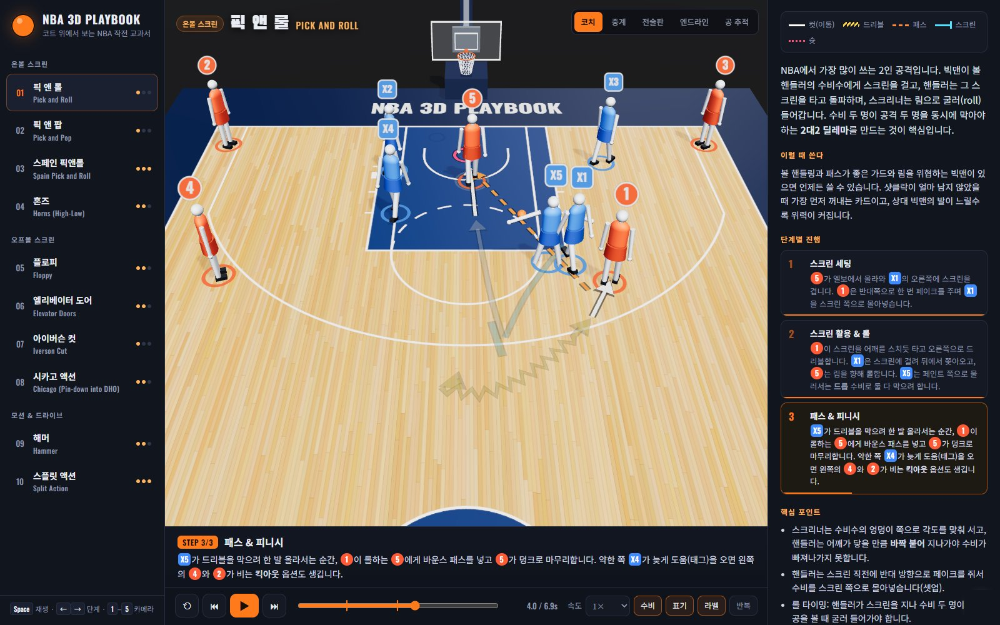

<p align="center"></p>
<h1 align="center">3D Hoops Playbook</h1>
<p align="center">
  20 offensive sets from pro basketball, each with the ways a defense plays it, replayed step by step on a 3D half court.<br>
  <a href="https://hpotty36.github.io/3d-hoops-playbook/"><b>Live demo →</b></a>
</p>

An interactive playbook that replays **20 offensive sets commonly run in pro basketball** on a 3D half court, step by step.
Players move at real game speed, coach-style diagram notation (cuts, dribbles, passes, screens) is drawn on the floor, and every step explains what is happening and why.
Every play also branches by **defensive read** — drop, switch, blitz, top lock and more, 74 reads in all counting each play's base version — so you see not just the play but how to beat each way of guarding it.

> The app is available in **English and Korean**. Use the `KO | EN` toggle at the top right, or open [`?lang=en`](https://hpotty36.github.io/3d-hoops-playbook/?lang=en) directly. A Korean version of this README is collapsed at the [bottom of the page](#korean).



## Plays

| # | Play | Category | Difficulty | In one line | Defensive reads |
|---|------|----------|:---:|------|------|
| 1 | Pick and Roll | On-ball screens | ●○○ | Screen → drive → hit the roller. The basic two-man game | Drop · Hedge · Switch · Blitz · Under |
| 2 | Pick and Pop | On-ball screens | ●○○ | The screener pops to the arc instead of rolling | Hedge · Switch · Up to touch · Rotation |
| 3 | Spain Pick and Roll | On-ball screens | ●●● | P&R plus a back screen on the roller's defender | Help on the roller · Stay home · Avoid the back screen · All switch |
| 4 | Horns (High-Low) | On-ball screens | ●●○ | Two bigs at the elbows: high P&R into a high-low pass | Big helps · Switch · Elbow denial · Force |
| 5 | Floppy | Off-ball screens | ●●○ | Shooter under the rim picks a single or staggered screen | Caught on screens · Trail · Top lock · Switch |
| 6 | Elevator Doors | Off-ball screens | ●●○ | Two screeners close the "doors" behind the shooter | Chase through · Go around · Switch · Help and recover |
| 7 | Iverson Cut | Off-ball screens | ●○○ | Wing-to-wing cut across the top of the key | Late chase · Chase under · Switch · Bump |
| 8 | Chicago | Off-ball screens | ●●○ | Pin-down screen straight into a dribble handoff | Caught on screens · Trail · Switch the handoff · Deny the handoff |
| 9 | Hammer | Motion & drive | ●●○ | Baseline drive + weak-side screen → corner three | Help · No help · Rotation switch · Take away the baseline |
| 10 | Split Action | Motion & drive | ●●● | Post entry, then the two off-ball players screen for each other | Chase the cutter · Switch · Stay with the screener · No post help |
| 11 | Side Pick and Roll | On-ball screens | ●●○ | Pick and roll on the wing, where ICE comes into play | ICE · Drop · Blitz · Switch |
| 12 | Ghost Screen | On-ball screens | ●●○ | The screener fakes the screen and slips out | Pre-switch · Show · Stay home |
| 13 | Weave | On-ball screens | ●●○ | Back-to-back dribble handoffs across the top | Trail · Switch · Under · Deny the handoff |
| 14 | Double Drag | Early offense | ●●○ | Two trailing bigs screen in a row: one pops, one rolls | Drop · Switch · Show |
| 15 | Pistol (21) | Early offense | ●●○ | An early dribble handoff from the 1 to the 2 on the wing | Drop · Show · Deny the handoff · Switch |
| 16 | Trailer Pop | Early offense | ●○○ | The trailing big screens for the ball, then pops for three | Drop · Up to touch · Switch |
| 17 | Flare Screen | Off-ball screens | ●●○ | A screen that lets the shooter fade away from the ball for a skip pass | Trail · Switch · Shortcut |
| 18 | Zipper | Off-ball screens | ●○○ | A cut from the block straight up the lane line to the top | Trail · Top lock · Switch |
| 19 | UCLA Cut | Off-ball screens | ●●○ | Pass to the wing, then cut to the rim off a high-post back screen | Caught on the screen · Help · Switch |
| 20 | Shuffle Cut | Off-ball screens | ●●○ | A diagonal cut from the far wing over a high-post screen | Caught on the screen · Switch · Help |

Each play comes with **step-by-step breakdown · when to use it · key teaching points · how defenses counter it · famous examples**.

### Defensive reads

A play is only half the story; the other half is what the defense does. Every play splits at a **branch point** into 3–5 reads:

- Watching from the start, playback stops at the branch point and asks how the defense plays it. Pick an answer and the play continues that way, with a one-line "why" under the caption.
- The tabs above the timeline switch reads at any time (a ◆ on the timeline marks the branch point). Before the branch point the switch is seamless; after it, playback jumps back to the branch.
- In the counters list, defenses with an animated read have a **Watch** button.
- `?read=switch#pick-and-roll` opens a read directly.

## Controls

| Input | Action |
|------|------|
| `Space` | Play / pause |
| `Enter` | Skip the reading pause and play the step now |
| `←` `→` | Previous / next step |
| `↑` `↓` | Previous / next play |
| `1`–`5` | Camera: Coach · Broadcast · Top-down board · Baseline · Ball follow |
| `D` `N` `L` | Toggle defense · floor notation · number labels |
| `R` | Restart |
| `T` | Switch between light and dark mode |
| `/` | Search plays |
| `?` | Show the keyboard shortcuts |
| Mouse drag / wheel | Orbit and zoom freely |

- Drag the timeline to freeze any moment; click a step in the right panel to jump to it.
- Play list: grouped by section and category, with search (Korean or English names and common aliases such as `PnR`) and a difficulty filter. On phones, tap the play title to open the list as a bottom sheet.
- Deep links: `#hammer` opens a play directly, `?cam=top&t=3.5#hammer` opens it paused at 3.5 s from the top-down camera, and `?read=blitz#pick-and-roll` opens a read.
- Language: the `KO | EN` toggle switches every label, caption, and play note without restarting playback. `?lang=en` or `?lang=ko` forces a language; otherwise your last choice (or the browser language) is used.
- Theme: the sun/moon button next to the language toggle switches between dark and light mode, including the 3D scene. Until you pick one, it follows your system setting.

### Reading mode

`1×` is real game speed, which is too fast to read along. So at the start of every step the playback pauses briefly: the court already shows that step's routes and highlights the players involved while you read the caption, then the action plays.

| Mode | Behavior |
|------|------|
| Auto (default) | Pause length scales with the caption length (2.5–10 s) |
| Relaxed | 1.7× longer than Auto |
| Step-by-step | Stops at every step until you press Play, `Space`, or `Enter` |
| Off | Continuous playback |

A ring countdown and a **Play now** button appear next to the caption. Your reading mode, speed, display toggles, language, and theme are remembered in the browser.

### Floor notation

| Mark | Meaning |
|------|------|
| White line + arrow | Cut (movement without the ball) |
| Yellow zigzag | Dribble |
| Orange dashes | Pass |
| Cyan line + T-bar | Screen |
| Pink dots | Shot |

Offense is shown as orange numbered circles (1–5), defense as blue `X1`–`X5`. While a screen is being set, a translucent "wall" appears in front of the screener.

## Run locally

It is a static site with no build step. Because it uses ES modules, serve it over HTTP instead of opening the file directly:

```bash
python -m http.server 8000
# or
npx serve .
```

Then open `http://localhost:8000`.

Checks for the play data (motion limits, KO/EN parity, read structure) run on Node 21+:

```bash
npm install
npm test
```

## Project structure

```
index.html            Layout and the Three.js import map
css/style.css         UI styles and light/dark theme tokens (3-column desktop / stacked mobile)
js/main.js            Entry point: scene setup, playback loop, UI wiring
js/engine.js          Compiles a play into a deterministic timeline (players, defense, ball)
js/court.js           Regulation half court (canvas texture) and the hoop
js/players.js         Mannequin player model, poses (run, defend, screen, shoot), ball
js/notation.js        Coach-board notation drawn on the floor
js/camera.js          Camera presets and transitions
js/i18n.js            UI strings (ko / en) and play-content localization
js/reads.js           Defensive reads: builds a play for the chosen read (pure)
js/reads-ui.js        Read tabs and the branch-point prompt
js/library.js         Searchable, sectioned play list
js/plays/*.js         Play definitions (one file per play, Korean + English content)
tests/                Play data and engine checks (npm test)
assets/logo-mark.svg  Logo mark (also the favicon)
docs/design.md        Design notes
```

## Adding a play

Create a file in `js/plays/` and register it in `js/plays/index.js`. Coordinates are in feet:

- `x`: left sideline `-25` to right sideline `25` (negative = offense's left)
- `z`: baseline `0` to half-court line `47`; the rim is at `(0, 5.25)`
- Common spots: top `[0, 31]`, wings `[±18, 22]`, corners `[±23, 3.5]`, elbows `[±8, 19.5]`, blocks `[±9, 8]`

```js
export default {
  id: 'my-play', category: 'onball', difficulty: 1,   // category: onball | offball | motion | early
  aliases: ['MP', 'my set'],                          // extra search terms, any language

  // Korean content (default)
  name: '내 작전', summary: '...', when: '...', keys: ['...'], famous: '...',
  counters: [{ name: '스위치', desc: '...', read: 'switch' }],   // read: links to an animated read

  // English content: same shape, steps are matched by index
  en: {
    name: 'My Play', summary: '...', when: '...', keys: ['...'], famous: '...',
    counters: [{ name: 'Switch', desc: '...' }],
    steps: [{ title: 'Set the screen', text: '[5] screens for [x1].' }],
    reads: {                                       // matched to the Korean reads by index
      prompt: 'How does the defense play the screen?',
      base: { label: 'Drop', why: '...' },
      options: [{ label: 'Switch', why: '...', steps: [{ title: '...', text: '...' }] }],
    },
  },

  start: { o1: [0, 32], o2: [-23, 3.5], o3: [23, 3.5], o4: [-19, 22], o5: [8, 18] },
  ball: 'o1',
  steps: [
    {
      title: '스크린 세팅',
      dur: 1.6,                                    // step length in seconds
      text: '[5]가 [x1]에게 스크린을 겁니다.',       // [1] = offense chip, [x1] = defense chip, **bold**
      move: {
        o5: [[2.6, 28.6]],                         // waypoints (starts from the current position)
        o1: { path: [[-1.8, 32.6]], t: [0.25, 0.85] }, // t: active window inside the step (0–1)
      },
      screens: [{ by: 'o5', face: [-1.5, 29.2] }], // face: the point the screen is set toward
      def: {
        d1: { lag: 0.9 },                          // reaction delay (looks "caught" on the screen)
        d5: { path: [[3, 17.5]] },                 // explicit defender path
        // guard: 'o5' (switch), sag: 0 (no help-side sag)
      },
      ball: [
        { type: 'pass', to: 'o5', at: 0.3 },       // pass | bounce | lob | skip | handoff
        { type: 'shot', at: 0.7, pts: 2, kind: 'dunk' }, // kind: jumper | layup | dunk
      ],
    },
  ],
};
```

To branch by defense, add a `reads` block. `at` is the number of shared steps; each option's `steps` replace everything after them, and the play's own remaining steps are the base read:

```js
  reads: {
    at: 1,
    prompt: '수비는 이 스크린을 어떻게 막을까요?',
    base: { id: 'drop', label: '드롭', why: '...' },
    options: [
      { id: 'switch', label: '스위치', why: '...', steps: [ /* same shape as steps above */ ] },
    ],
  },
```

Any field missing from the `en` block falls back to Korean. Unless you script them, defenders position themselves automatically: between their man and the rim, sagging toward the paint when they are far from the ball. Run `npm test` after editing: it fails on unrealistic speeds, overlapping players, shot distances that do not match the points, missing translations, and reads that do not share the opening exactly.

## Tech

- [Three.js](https://threejs.org/) r160 via CDN and an import map. No bundler or build tools
- Court lines and hardwood are a canvas-drawn texture; players are built from primitive shapes
- Type: [Rubik](https://fonts.google.com/specimen/Rubik) for Latin text, numbers, and court labels; [Pretendard](https://github.com/orioncactus/pretendard) for Korean
- Every position is a pure function of time `t`, so you can scrub the timeline back and forth precisely
- `npm test` uses Node's built-in test runner; the site itself needs no install

## License & disclaimer

Code is released under the [MIT License](LICENSE).

This is an unofficial, non-commercial educational project. It is **not affiliated with, endorsed by, or sponsored by any professional league, team, or player**. Team and player names are trademarks or names of their respective owners and appear only to describe where these publicly known basketball tactics have been used. No logos, player images, or other official assets are used.

---

<a name="korean"></a>

<details>
<summary><strong>🇰🇷 한국어 README 펼치기 (Korean)</strong></summary>

### 3D Hoops Playbook

프로 농구에서 자주 쓰이는 공격 작전 20가지를 **3D 코트 위에서 단계별로 재생하며** 배우는 인터랙티브 플레이북입니다.
선수들이 실제로 움직이고, 코트 바닥에는 코치들이 쓰는 전술판 표기(컷·드리블·패스·스크린)가 그려지며, 단계마다 지금 무슨 일이 일어나는지 한국어로 설명합니다.
작전마다 **수비 대응별 분기**(드롭, 스위치, 블리츠, 탑 락킹 등 기본 읽기를 포함해 모두 74가지)가 있어서, 작전 자체뿐 아니라 수비가 어떻게 나올 때 어떻게 풀어야 하는지까지 볼 수 있습니다.

**▶ 바로 보기: https://hpotty36.github.io/3d-hoops-playbook/**

### 수록 작전

| # | 작전 | 분류 | 난이도 | 한 줄 요약 | 수비 대응별 분기 |
|---|------|------|:---:|------|------|
| 1 | 픽 앤 롤 | 온볼 스크린 | ●○○ | 스크린 → 돌파 → 롤맨에게 패스, 가장 기본적인 2인 공격 | 드롭 · 헤지 · 스위치 · 블리츠 · 언더 |
| 2 | 픽 앤 팝 | 온볼 스크린 | ●○○ | 스크리너가 림 대신 3점 라인으로 빠져 슈팅 | 헤지 · 스위치 · 업 투 터치 · 로테이션 |
| 3 | 스페인 픽앤롤 | 온볼 스크린 | ●●● | 픽앤롤 + 롤맨 수비에게 거는 백스크린 | 롤맨 도움 · 슈터 고정 · 백스크린 피하기 · 올 스위치 |
| 4 | 혼즈 | 온볼 스크린 | ●●○ | 엘보의 두 빅맨, 하이 픽앤롤 → 하이-로우 | 빅맨 도움 · 스위치 · 엘보 디나이 · 한쪽으로 몰기 |
| 5 | 플로피 | 오프볼 스크린 | ●●○ | 림 아래 슈터가 싱글/스태거 스크린 중 선택 | 스크린에 걸림 · 트레일 · 탑 락킹 · 스위치 |
| 6 | 엘리베이터 도어 | 오프볼 스크린 | ●●○ | 두 스크리너가 문을 닫듯 수비를 가둠 | 뒤따라가기 · 문 바깥으로 돌기 · 스위치 · 헬프 앤 리커버 |
| 7 | 아이버슨 컷 | 오프볼 스크린 | ●○○ | 자유투 라인 위를 가로지르는 엔트리 컷 | 늦은 추격 · 언더 추격 · 스위치 · 범프 |
| 8 | 시카고 액션 | 오프볼 스크린 | ●●○ | 핀다운 스크린 → 드리블 핸드오프 | 스크린에 걸림 · 트레일 · 핸드오프 스위치 · 핸드오프 차단 |
| 9 | 해머 | 모션 & 드라이브 | ●●○ | 베이스라인 돌파 + 약한 쪽 스크린 → 코너 3점 | 도움 수비 · 노 헬프 · 로테이션 스위치 · 베이스라인 차단 |
| 10 | 스플릿 액션 | 모션 & 드라이브 | ●●● | 포스트 엔트리 후 공 없는 두 선수의 스크린 | 커터 쫓기 · 스위치 · 스크리너 고정 · 포스트 도움 금지 |
| 11 | 사이드 픽앤롤 | 온볼 스크린 | ●●○ | 윙에서 거는 픽앤롤, 아이스 수비가 등장 | 아이스 · 드롭 · 블리츠 · 스위치 |
| 12 | 고스트 스크린 | 온볼 스크린 | ●●○ | 스크린을 거는 척하다 빠지는 스크리너 | 미리 스위치 · 쇼 · 그대로 |
| 13 | 위브 | 온볼 스크린 | ●●○ | 탑에서 이어지는 연속 핸드오프 | 트레일 · 스위치 · 언더 · 핸드오프 차단 |
| 14 | 더블 드래그 | 얼리 오펜스 | ●●○ | 뒤따라온 빅맨 둘의 연속 스크린: 한 명은 팝, 한 명은 롤 | 드롭 · 스위치 · 쇼 |
| 15 | 피스톨 (21) | 얼리 오펜스 | ●●○ | 1번이 윙에서 2번에게 건네는 이른 핸드오프 | 드롭 · 쇼 · 핸드오프 차단 · 스위치 |
| 16 | 트레일러 팝 | 얼리 오펜스 | ●○○ | 늦게 따라온 빅맨이 스크린을 건 뒤 3점 라인 밖으로 팝 | 드롭 · 업 투 터치 · 스위치 |
| 17 | 플레어 스크린 | 오프볼 스크린 | ●●○ | 슈터가 공에서 멀어지며 스킵 패스를 받게 해 주는 스크린 | 트레일 · 스위치 · 지름길 |
| 18 | 지퍼 | 오프볼 스크린 | ●○○ | 블록에서 페인트 옆 선을 따라 탑까지 곧장 올라오는 컷 | 트레일 · 탑 락킹 · 스위치 |
| 19 | UCLA 컷 | 오프볼 스크린 | ●●○ | 윙에 패스한 뒤 하이포스트 백스크린을 타고 림으로 컷 | 스크린에 걸림 · 도움 수비 · 스위치 |
| 20 | 셔플 컷 | 오프볼 스크린 | ●●○ | 먼 쪽 윙에서 하이포스트 스크린을 넘는 대각선 컷 | 스크린에 걸림 · 스위치 · 도움 수비 |

작전마다 **단계별 진행 · 이럴 때 쓴다 · 핵심 포인트 · 수비는 어떻게 막나 · 대표 사례**가 들어 있습니다.

### 수비 대응별 분기

작전은 절반이고, 나머지 절반은 수비가 어떻게 나오느냐입니다. 모든 작전이 **분기점**에서 3~5가지 읽기로 갈라집니다.

- 처음부터 보면 분기점에서 재생이 멈추고 "수비는 어떻게 막을까요?"라고 묻습니다. 답을 고르면 그 방식으로 이어지고, 설명 위에 '왜 이렇게 푸는지' 한 줄이 붙습니다.
- 타임라인 위 탭으로 언제든 읽기를 바꿀 수 있습니다(타임라인의 ◆가 분기점). 분기점 전에는 끊김 없이 바뀌고, 지난 뒤라면 분기점으로 돌아갑니다.
- '수비는 어떻게 막나' 목록에서 애니메이션이 있는 대응에는 **보기** 버튼이 있습니다.
- `?read=switch#pick-and-roll`처럼 특정 읽기를 바로 열 수 있습니다.

### 사용법

| 조작 | 기능 |
|------|------|
| `Space` | 재생 / 일시정지 |
| `Enter` | 읽는 시간을 건너뛰고 바로 재생 |
| `←` `→` | 이전 / 다음 단계 |
| `↑` `↓` | 이전 / 다음 작전 |
| `1`–`5` | 카메라: 코치 · 중계 · 전술판(탑뷰) · 엔드라인 · 공 추적 |
| `D` `N` `L` | 수비 · 전술판 표기 · 번호 라벨 켜고 끄기 |
| `R` | 처음부터 다시 |
| `T` | 라이트 / 다크 모드 전환 |
| `/` | 작전 검색 |
| `?` | 단축키 안내 열기 |
| 마우스 드래그 / 휠 | 자유롭게 회전 · 확대 |

- 타임라인을 드래그하면 원하는 순간에 멈춰서 볼 수 있고, 오른쪽 패널의 단계를 누르면 그 단계로 바로 이동합니다.
- 작전 목록은 갈래·유형별로 묶여 있고, 검색(한국어·영어 이름, `PnR` 같은 별칭)과 난이도 필터를 쓸 수 있습니다. 휴대전화에서는 작전 제목을 누르면 목록이 아래에서 올라옵니다.
- 주소 뒤에 `#hammer`처럼 작전 id를 붙이면 그 작전이 바로 열리고, `?cam=top&t=3.5#hammer`처럼 붙이면 그 장면에서 멈춘 채로, `?read=blitz#pick-and-roll`처럼 붙이면 그 읽기로 열립니다.
- 오른쪽 위 `KO | EN` 토글로 언어를 바꿀 수 있습니다. 재생은 멈추지 않고 모든 문구와 설명이 바로 바뀝니다. `?lang=ko` / `?lang=en`으로 언어를 지정해 열 수도 있습니다.
- 언어 토글 옆 해/달 버튼으로 다크 모드와 라이트 모드를 바꿀 수 있습니다(3D 코트 배경까지 함께 바뀜). 직접 고르기 전에는 시스템 설정을 따릅니다.

### 읽기 모드

1배속은 실제 경기 속도라서 설명을 읽으며 따라가기엔 빠릅니다. 그래서 단계가 시작될 때마다 잠깐 멈추고, 그동안 코트에는 이번 단계의 동선과 관련 선수가 먼저 표시됩니다. 설명을 다 읽으면 그 단계가 실제 속도로 재생됩니다.

| 모드 | 동작 |
|------|------|
| 자동 (기본) | 설명 길이에 맞춰 2.5–10초 멈춤 |
| 넉넉히 | 자동보다 1.7배 길게 멈춤 |
| 단계별 | 단계마다 멈추고 재생(`Space`/`Enter`)을 누를 때까지 기다림 |
| 끄기 | 멈추지 않고 이어서 재생 |

설명 옆에 원형 카운트다운과 **바로 재생** 버튼이 나타납니다. 읽기 모드, 속도, 표시 옵션, 언어, 테마는 브라우저에 저장됩니다.

### 전술판 표기

| 표기 | 의미 |
|------|------|
| 흰 실선 + 화살표 | 컷(공 없이 이동) |
| 노란 지그재그 | 드리블 |
| 주황 점선 | 패스 |
| 하늘색 선 + T자 | 스크린 |
| 분홍 점선 | 슛 |

공격은 주황색 원형 번호(1–5), 수비는 파란색 `X1`–`X5`로 표시합니다. 스크린을 거는 순간에는 스크리너 앞에 반투명한 '벽'이 나타납니다.

### 로컬에서 실행

빌드 과정이 없는 정적 사이트입니다. ES 모듈을 쓰기 때문에 파일을 더블클릭하지 말고 간단한 웹 서버로 여세요.

```bash
python -m http.server 8000
```

그다음 브라우저에서 `http://localhost:8000`을 엽니다.

작전 데이터 검사(움직임 한계, 한/영 짝, 분기 구조)는 Node 21 이상에서 `npm install` 후 `npm test`로 실행합니다.

### 작전 추가하기

`js/plays/`에 파일을 하나 만들고 `js/plays/index.js`에 등록하면 됩니다. 좌표 단위는 피트(ft)이고, 형식은 위 영어 섹션의 예시와 같습니다. 한국어 내용은 파일 본문에, 영어 내용은 `en` 블록에 같은 구조로 넣습니다(빠진 항목은 한국어로 표시).

- `x`: 왼쪽 사이드라인 `-25` ~ 오른쪽 사이드라인 `25` (공격 방향 기준 왼쪽이 음수)
- `z`: 베이스라인 `0` ~ 하프라인 `47`, 림 중심은 `(0, 5.25)`
- 수비는 따로 지정하지 않으면 자기 선수와 림 사이에 서고, 공에서 멀면 도움 수비 위치로 처집니다.
- 수비 대응별 분기는 `reads` 블록으로 넣습니다. `at`은 공유하는 단계 수이고, 각 읽기의 `steps`가 그 뒤를 대신합니다(형식은 위 영어 섹션 참고). `aliases`에는 검색용 별칭을 넣습니다.
- 수정한 뒤에는 `npm test`를 실행하세요. 비현실적인 속도, 겹치는 선수, 점수와 맞지 않는 슛 거리, 빠진 번역, 공유 구간이 어긋난 읽기를 잡아냅니다.

### 라이선스 및 면책

코드는 [MIT 라이선스](LICENSE)로 공개합니다.

이 프로젝트는 비영리·비공식 교육용 자료이며 **특정 프로 리그·구단·선수와 관련이 없고, 승인이나 후원을 받지 않았습니다.** 구단명과 선수 이름은 각 소유자의 상표 또는 이름이며, 공개적으로 알려진 농구 전술이 쓰인 사례를 설명하기 위해서만 언급합니다. 로고, 선수 사진 등 공식 자료는 사용하지 않습니다.

</details>
